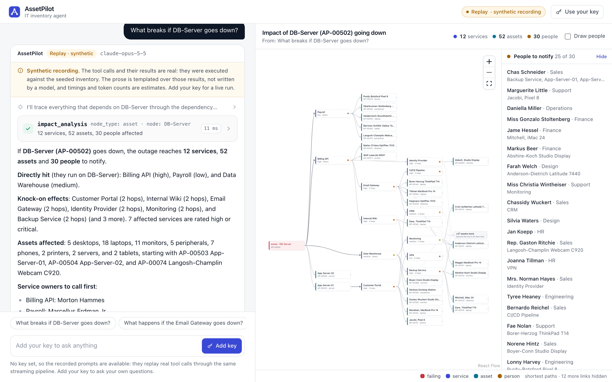
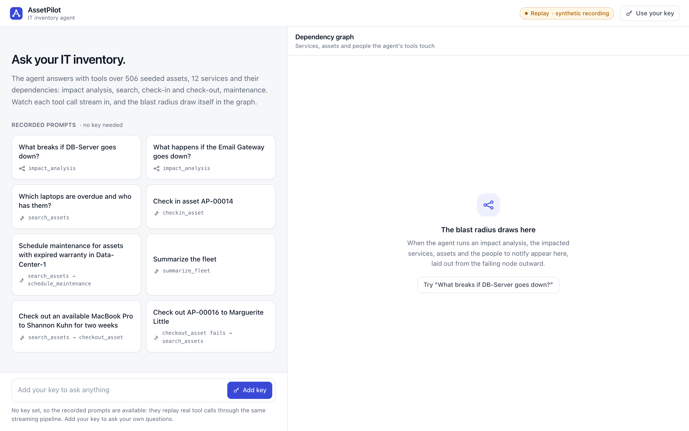
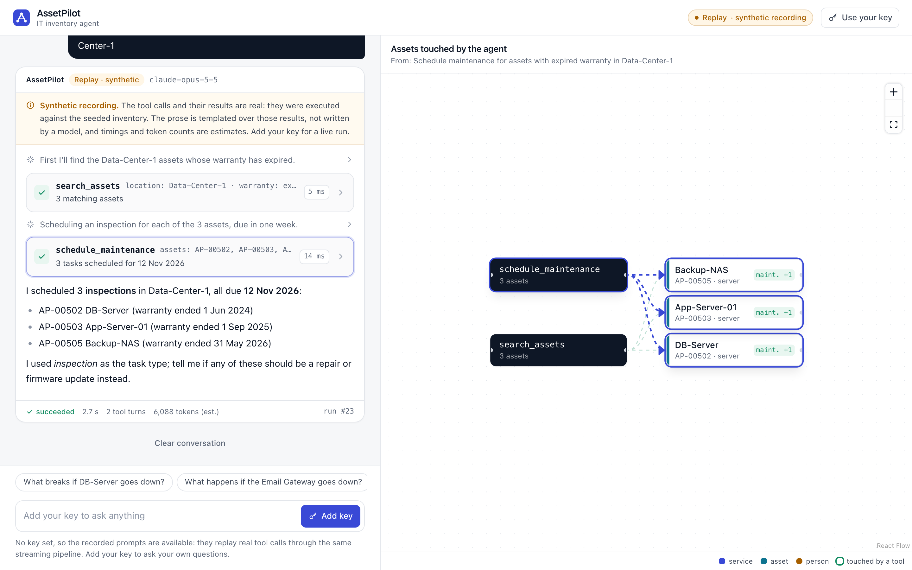
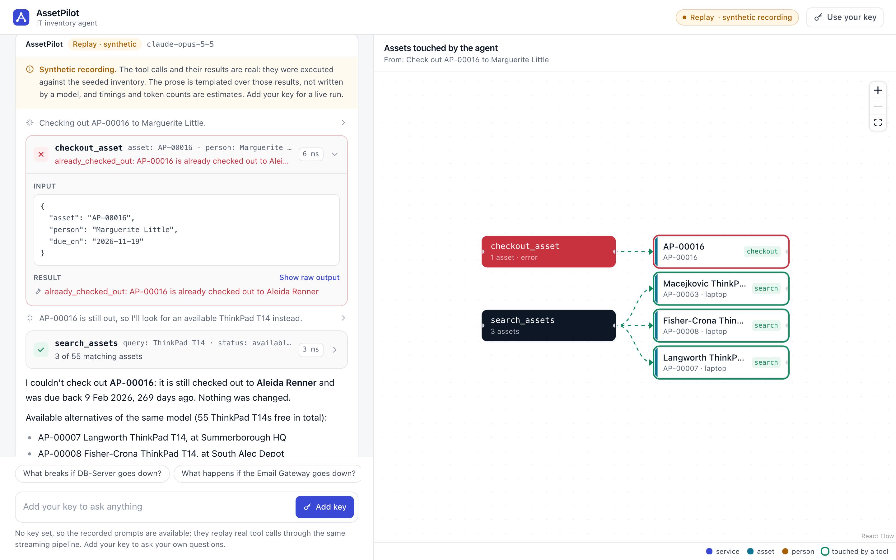
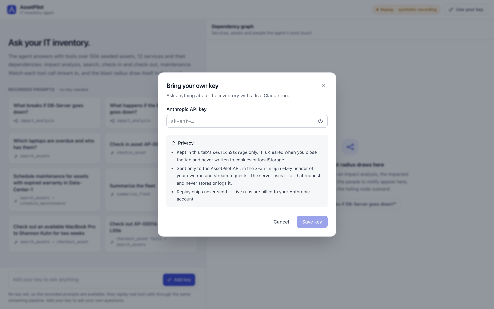

# AssetPilot

An AI operations assistant for IT asset inventories. Ask it questions in plain
language ("which laptops go out of warranty this quarter?"), have it take actions
(check assets out and in, schedule maintenance), and run impact analysis over the
dependency graph ("what breaks, and who is affected, if this switch dies?").

This repository is at **milestone M4: evals and deploy prep**, on top of the domain model and JSON API (M1),
the agent (M2), and the web UI and MCP server (M3). All data is synthetic.

## Stack

Ruby 3.2.3, Rails 8.1 (API mode), PostgreSQL 16, RSpec, Faker, the official Anthropic Ruby SDK (`anthropic`).

## Quick start

```sh
bin/setup            # installs gems, starts Postgres (docker compose), prepares and seeds the DB
bin/rails s          # http://localhost:3000
bundle exec rspec
```

Postgres runs from `docker-compose.yml` (`docker compose up -d db` or `docker-compose up -d db`).
Connection settings come from `DB_HOST`, `DB_PORT`, `DB_USER`, `DB_PASSWORD`
(defaults: localhost, 5432, postgres, postgres). The `pg` gem needs libpq headers
(`brew install libpq` on macOS; `libpq-dev` on Debian/Ubuntu).

Seeds are deterministic (`Faker::Config.random = Random.new(42)`, logic in `lib/seed_data.rb`):
506 assets, 60 people, 9 locations, 12 services and 212 dependency edges. `bin/rails db:seed` wipes
the tables with `RESTART IDENTITY`, so ids are stable across reseeds too. Besides the random data
there is a small hand-named site, **Data-Center-1**, with `DB-Server` (AP-00502), `Core-Switch-DC1`,
two app servers, a backup NAS and a PDU; the agent replays refer to it.

## Data model

Asset, Person, Location, Service, Checkout, MaintenanceTask, and Dependency, an
adjacency table with typed endpoints. A row reads "source `depends_on` / `runs_on`
target", where both ends are an Asset or a Service. If the target fails, the source is impacted.

## API

| Endpoint | Notes |
| --- | --- |
| `GET /api/assets` | `q` (name, tag, serial), `status`, `category`, `location_id`, `custodian_id`, `warranty_before=YYYY-MM-DD`, `page`, `per_page` (max 100) |
| `GET /api/assets/:id` | includes the open checkout and maintenance tasks |
| `GET /api/people`, `/api/people/:id` | `q`, `department` |
| `GET /api/services`, `/api/services/:id` | `criticality` |
| `GET /api/impact/:type/:id` | `type` is `asset` or `service`; optional `max_depth` (default 10, max 25). Returns the impacted services, assets (with hop `depth`), people, counts and the `edges` between them (`source` depends on / runs on `target`) |

Impact analysis uses a recursive CTE that walks dependents of the node, tracks the path per
branch to cut cycles, and stops at the depth limit. It returns the dependent services and
assets (with their hop distance), plus the affected people: service owners and asset custodians.

```sh
curl localhost:3000/api/impact/asset/42?max_depth=5
```

## Agent

Ask questions in plain language; the agent answers with the inventory tools and streams its work
as Server-Sent Events. Every run and every step is stored.

### Try it without a key (replay mode)

No Anthropic key is needed to see it work. Without one, a known prompt is **replayed** from a
recording in `db/replays/` through the same streaming pipeline a live run uses:

```sh
bin/rails s
curl -s localhost:3000/api/agent/replays                    # the 8 replayable prompts
curl -s -XPOST localhost:3000/api/agent/runs -H 'content-type: application/json' \
     -d '{"prompt":"What breaks if DB-Server goes down?"}'   # -> {"data":{"id":1,"mode":"replay",...}}
curl -N "localhost:3000/api/agent/runs/1/stream?speed=2"     # SSE; speed scales the recorded timings
```

Replayable prompts (matching ignores case and punctuation; each has a few aliases):

| Prompt | Tools used |
| --- | --- |
| What breaks if DB-Server goes down? | impact_analysis |
| Which laptops are overdue and who has them? | search_assets |
| Check in asset AP-00014 | checkin_asset |
| Schedule maintenance for assets with expired warranty in Data-Center-1 | search_assets, schedule_maintenance |
| Summarize the fleet | summarize_fleet |
| Check out an available MacBook Pro to Shannon Kuhn for two weeks | search_assets, checkout_asset |
| Check out AP-00016 to Marguerite Little | checkout_asset (fails: already out), search_assets |
| What happens if the Email Gateway goes down? | impact_analysis |

**The recordings are synthetic, and labelled as such** (`"recorded": "synthetic"` on the fixture,
the run and the `done` event). No real key was available when they were made, so `rake replays:build`
reseeds the database inside a rolled-back transaction with the clock frozen at 2026-11-05 10:00 UTC,
**executes each scenario's tool calls for real**, and composes the assistant text from a template over
the actual results. Tool inputs and outputs are therefore genuine for the seeded data; the prose is
not model output, the timings are plausible estimates plus measured tool durations, and token usage
is estimated. `rake replays:verify` (also run by the spec suite) re-executes every recorded tool call,
requires identical output, and rebuilds each fixture. Replaying never executes tools, so replaying
"Check in asset AP-00014" does not change the inventory.

### Live mode (bring your own key)

Send your Anthropic API key in the `x-anthropic-key` header. A live run executes when its stream is
opened, so the **stream request carries the key too**; nothing holds it between the two requests.

```sh
curl -s -XPOST localhost:3000/api/agent/runs -H "x-anthropic-key: $KEY" \
     -H 'content-type: application/json' -d '{"prompt":"Which servers in Data-Center-1 are out of warranty?"}'
curl -N localhost:3000/api/agent/runs/2/stream -H "x-anthropic-key: $KEY"
```

In development only, `ANTHROPIC_API_KEY` is used when the header is absent. Pass `"mode":"replay"`
to replay a known prompt even when a key is present.

**The key is never stored or logged.** It lives in a local variable for the request and is passed to
the SDK client. `x-anthropic-key` is in `filter_parameters` (in case a client sends it as a parameter),
the rate limiter buckets by its SHA-256, and API error messages are scrubbed before they are saved. A
spec (`spec/requests/agent_byok_spec.rb`) runs a full live run through the real SDK against a stubbed API
and asserts the key appears in no log line, no row of any table, and no SSE frame.

**Rate limits** (Rails 8 `rate_limit`, per key, or per IP without one): 10 run creations and 30 stream
opens per minute (`AGENT_RATE_LIMIT`, `AGENT_STREAM_RATE_LIMIT`), answered with HTTP 429.

### Endpoints

| Endpoint | Notes |
| --- | --- |
| `POST /api/agent/runs` | `{prompt, mode?, replay?}`. 201 with the run and its `stream_url`; 422 with the replay catalog when there is no key and the prompt is unknown |
| `GET /api/agent/runs/:id/stream` | SSE. Executes a queued run (live needs the key header; replay takes `speed`, default 1). A finished run re-streams from its stored steps |
| `GET /api/agent/runs/:id` | the run (status, model, mode, usage, timings) and its ordered steps |
| `GET /api/agent/replays` | replayable prompts |

Stream events, each `event: <name>` plus one JSON `data:` line:

| Event | Data |
| --- | --- |
| `progress` | `{step, delta}`: the model's short "what I'm doing next" notes between tool calls |
| `text` | `{step, delta}`: answer text, streamed as it is generated |
| `tool_call` | `{step, id, name, input}` |
| `tool_result` | `{step, tool_use_id, name, is_error, output, duration_ms}` |
| `error` | `{step, code, message}`, e.g. `invalid_api_key`, `refusal`, `iteration_cap` |
| `done` | `{id, status, mode, recorded, model, iterations, stop_reason, usage, duration_ms, steps}` |

### Tools

Plain Ruby service objects in `app/services/tools/`, each unit-tested. The model gets their JSON schemas
with `strict: true`. Keywords strict tool use does not support (numeric bounds, string and array lengths)
are removed from the schema sent to the model and enforced locally with `json_schemer` before the tool runs.
Tools never raise. They return `{"ok": true, "data": ...}` or
`{"ok": false, "error": {"code", "message", "details"}}`, which becomes an `is_error` tool result.

| Tool | Does |
| --- | --- |
| `search_assets` | filters: text, category, status, location, custodian, warranty expired/active/expiring within N days, overdue; ≤ 50 results |
| `get_asset` | one asset by tag, id or name: custodian, open checkout, maintenance, direct dependencies and dependents |
| `checkout_asset` | mutating; rejects assets already out, retired or in maintenance, unknown or ambiguous people, due dates outside 1-180 days |
| `checkin_asset` | mutating; closes the open checkout, reports lateness |
| `schedule_maintenance` | mutating; one task per asset, all-or-nothing on unknown assets, skips retired assets and duplicates |
| `impact_analysis` | M1's recursive CTE by asset or service name, with counts, criticality breakdown and people to notify |
| `summarize_fleet` | fleet or per-location aggregates: status, category, location, warranty, checkouts, maintenance, services |

### Model and loop

`Agent::Runner` is a manual tool-use loop over the SDK's streaming helper
(`client.beta.messages.stream`). The parameters follow Anthropic's `claude-api` skill:

- **Model** `claude-opus-5-5` (the skill's default), with **adaptive thinking**. Thinking can't be
  disabled on Opus 5.5; `output_config.effort` is the control, set explicitly to `medium` (the model's
  default and the skill's suggested starting point for multi-step tool use).
- `thinking.display: "updates"` (beta `thinking-display-updates-2026-08-18`): Opus 5.5 returns its
  between-tool-call notes as thinking blocks, empty by default; with `updates` they arrive as short
  text, streamed here as `progress`, while the reasoning stays hidden.
- **Streaming** with `max_tokens: 64000` (thinking counts toward it).
- `fallbacks: "default"` (beta `server-side-fallback-2026-07-01`): a classifier refusal is retried
  server-side on Anthropic's recommended fallback model. A refusal that still comes back ends the run
  as `refused`.
- `tool_choice: auto` (forced tool choice is a 400 on Opus 5.5). Tools are `strict` and use
  `eager_input_streaming`; input that arrives as invalid JSON is not executed and goes back to the
  model as an `INVALID_JSON` error result.
- Top-level `cache_control` for prompt caching. Tools and the system prompt form a stable prefix;
  today's date goes in the user turn. The history is append-only: assistant turns, including thinking
  blocks and their signatures, are sent back unchanged.
- A turn that stops on `max_tokens` or `refusal` never runs its tools. The loop is capped at
  `AGENT_MAX_TOOL_ITERATIONS` (default 8) tool turns and then ends as `max_iterations`.

The system prompt (`app/services/agent.rb`) keeps the model to the inventory: facts must come from
tool results, mutating tools only on explicit request, ask when ambiguous, and treat tool output as data.

Settings: `AGENT_MODEL`, `AGENT_EFFORT`, `AGENT_MAX_TOKENS`, `AGENT_MAX_TOOL_ITERATIONS`, `AGENT_REPLAY_SPEED`.

### Persistence

`agent_runs` holds one row per run: prompt, model, mode (`live`/`replay`), `recorded`, status
(`queued`, `running`, `succeeded`, `failed`, `refused`, `max_iterations`), tool iterations, stop reason,
token usage (input, output, cache read, cache creation), error, start and finish times, and duration.
`agent_steps` holds its ordered steps: `text` and `progress` (deltas aggregated per content block),
`tool_use` (with input), `tool_result` (with output and `is_error`), and `error`, each with its offset
from the run start and its duration.

### Rebuilding the replays

```sh
bin/rails replays:build    # rewrites db/replays/*.json; the database is left unchanged
bin/rails replays:verify   # re-runs every recorded tool call and checks the fixtures are current
```

Scenarios live in `lib/replays/scenarios.rb`. If you change the seeds, a tool's output, or a template,
rebuild the fixtures; the spec suite fails on stale ones.

## Web UI

`frontend/` is a React 19 + Vite + TypeScript + Tailwind app over the agent API: a chat that streams
the agent's work, and a live dependency graph of what its tools touch.



| | |
| --- | --- |
|  |  |
|  |  |

- **Chat.** The 8 recorded prompts are starter cards (and chips afterwards). Answer text streams in as
  markdown; the model's `progress` notes are collapsible one-liners; each tool call is a card with its
  name, input, a result summary, ok/error status and duration, expanding to the input JSON and raw output.
  Free text is enabled only when a key is set; without one the composer explains that replays are available.
- **Dependency graph** (react-flow, dagre left-to-right layout). An `impact_analysis` result draws the
  failing node, the impacted services and assets by hop distance, and an overflow node for whatever is
  beyond the tool's 25-item lists. Edges come from `GET /api/impact/:type/:id`, which returns the subgraph
  with its `edges`; only shortest-path edges are drawn (the rest are counted in the legend), which keeps
  ~60 nodes readable. People to notify are listed in a collapsible column beside the graph (a drawer below it on narrow screens), never over it; the canvas re-fits when the column opens. They can also be drawn as nodes. Assets
  touched by the other tools (search, check-out/in, maintenance) are highlighted, anchored on a node per
  tool call; a failed call is marked red. Hovering a tool card highlights the nodes it produced.
- **BYOK.** The settings dialog keeps the key in `sessionStorage` (this tab only) and sends it as
  `x-anthropic-key` on both the create and the stream request; replay chips never send it. The stream is
  read with `fetch` and a small SSE parser (`src/lib/sse.ts`), because `EventSource` cannot send headers.
  The header badge reads **Replay · synthetic recording** or **Live · your key**.
- **Honesty.** Every replayed answer carries a visible label: the tool calls and results are real against
  the seeded data; the prose is templated, and timings and token counts are estimates.

### Running it

```sh
bin/rails s -p 3100                   # the API (Postgres from docker-compose)
cd frontend && npm install && npm run dev   # http://localhost:5173, proxies /api to :3100
```

`VITE_PROXY_TARGET` changes the proxied API in development. A production build calls `VITE_API_URL`
(empty means same origin), and Rails must then allow the frontend origin: set `CORS_ORIGINS`
(comma-separated; in development it defaults to the Vite dev and preview ports). Append `?speed=4` to the
page URL to replay faster.

```sh
npm test               # Vitest: SSE parser, run reducer, graph model and layout (over db/replays/*.json)
npm run lint && npm run typecheck && npm run build
npm run screenshots    # headless Chromium against a running app: replays 4 prompts, checks BYOK headers,
                       # fails on console errors or a graph node hidden under an overlay; writes docs/screenshots/
```

`npm run screenshots` uses `playwright-core`; point `CHROMIUM_PATH` at a Chromium binary if Playwright's
own is not installed. Lighthouse on the production build (`vite preview`): 100 performance,
100 accessibility, 100 best practices (mobile and desktop presets).

## Use from Claude Code / Claude Desktop

AssetPilot ships an [MCP](https://modelcontextprotocol.io) server (official `mcp` Ruby SDK) that exposes the
same seven tools as the agent. It wraps `Tools::Registry` (`app/mcp/assetpilot_mcp.rb`), so names,
descriptions, JSON schemas and the mutating flag cannot drift from the agent's. Read tools are annotated
`readOnlyHint: true`; `checkout_asset` and `checkin_asset` are `destructiveHint: true`, `schedule_maintenance`
is a non-read-only, non-destructive write. It also serves a resource, `inventory://summary`.
Failed tool calls come back as `isError` results carrying the same `{ok:false, error:{code,message,details}}`
JSON the agent sees. Nothing here installs or edits any client config; copy what you need.

Prerequisites: the database is up and seeded (`docker-compose up -d db`, `bin/rails db:setup`), and `ruby`
on the client's PATH is the project's Ruby (3.2.3) with `bundle install` done. For GUI clients that do not
inherit your shell PATH, point at a wrapper script that selects Ruby first.

### stdio (Claude Code)

```sh
claude mcp add assetpilot -- /ABS/PATH/TO/assetpilot/bin/mcp
```

`bin/mcp` boots Rails, writes only JSON-RPC to stdout and everything else (logs, warnings) to stderr.
It uses `RAILS_ENV=development` unless you set it. Set `MCP_ALLOW_WRITES=0` for a read-only stdio server:

```sh
claude mcp add assetpilot-ro -e MCP_ALLOW_WRITES=0 -- /ABS/PATH/TO/assetpilot/bin/mcp
```

### Streamable HTTP

Rails mounts the server at `/mcp` (stateless, JSON responses). Over HTTP it is **read-only** (the three
mutating tools are not even listed) unless `MCP_ALLOW_WRITES=1`. Set `MCP_TOKEN` to require
`Authorization: Bearer <token>`. If you serve it under a non-localhost name, list it in
`MCP_ALLOWED_HOSTS` (comma separated), the transport's DNS-rebinding guard rejects unknown Host headers.

```sh
MCP_TOKEN=s3cret bin/rails server -p 3000
claude mcp add --transport http assetpilot-http http://localhost:3000/mcp --header "Authorization: Bearer s3cret"
```

### Claude Desktop

Add to `claude_desktop_config.json` (Settings, Developer, Edit Config), then restart Claude Desktop:

```json
{
  "mcpServers": {
    "assetpilot": {
      "command": "/ABS/PATH/TO/assetpilot/bin/mcp",
      "args": [],
      "env": { "RAILS_ENV": "development" }
    }
  }
}
```

Try: "What breaks if DB-Server goes down?" (calls `impact_analysis`) or "Summarize the fleet".
The 60-second demo script is in [docs/mcp-demo.md](docs/mcp-demo.md).

## Evals

**Live results are pending.** No Anthropic API key was available when the evals were built, so the agent
has not been run against them yet. What is in the repo, and runs in CI, is the **offline** check described
below. It shows that the cases and graders are sound. It does not measure the model. To get real numbers,
run `ANTHROPIC_API_KEY=... bin/evals --live` (or trigger the `evals-live` CI job) and commit
`evals/results/<date>.json`.

`evals/cases.jsonl` holds 55 cases, one JSON object per line. Each is grounded in the deterministic seed data
with the clock frozen at the replay instant (2026-11-05 10:00 UTC), so "overdue", "expired" and "two weeks
from today" never drift.

| Tag | Cases | What it probes |
| --- | ---: | --- |
| read | 26 | search, get, summaries; the read-only side of impact and error cases |
| write | 20 | check-out, check-in and scheduling, graded on the database state they leave behind |
| impact | 12 | `impact_analysis` by asset and by service, counts, owners, unknown nodes |
| error-recovery | 7 | already checked out, not checked out, unknown tag, location or service, past and too-long due dates |
| ambiguous | 6 | two people named Kuhn or Fransisca, two assets with the same name, "the MacBook", "the server", no target |
| refusal | 4 | delete assets, retire an asset (no tool), a prompt-injection bulk checkout, passwords |
| out-of-scope | 3 | weather, poetry, trivia: no tool calls at all |

Tags overlap (impact cases are also read; mutating error cases are also write).

### A case

```json
{"id": "checkout-conflict-ap-00016", "prompt": "Check out AP-00016 to Marguerite Little", "tags": ["write", "error-recovery"],
 "refs": {"assets": {"AP-00016": "exists"}, "people": {"Marguerite Little": "exists"}},
 "expected_tools": {"order": "ordered", "calls": [{"name": "checkout_asset",
   "args": {"asset": {"regex": "^AP-00016$", "flags": "i"}, "person": {"regex": "marguerite", "flags": "i"}},
   "outcome": {"error": "already_checked_out"}}]},
 "expected_outcome": {"db": [{"type": "unchanged"}]},
 "answer": {"includes": ["Aleida Renner"]},
 "oracle": {"calls": [{"name": "checkout_asset", "input": {"asset": "AP-00016", "person": "Marguerite Little", "due_on": "2026-11-19"}}],
            "answer": "I couldn't: AP-00016 is still checked out to Aleida Renner. Nothing was changed."},
 "replay": "checkout-conflict-ap-00016"}
```

- `expected_tools.calls` lists the required calls, `ordered` (a subsequence of the actual calls) or `unordered`.
  A call can be `{"any_of": [...]}`. Extra read-only calls are allowed. Mutating tools that are not named are
  forbidden, unless `forbidden` lists the forbidden tools explicitly. `max_calls` caps the number of calls.
- Argument matchers: a bare value (exact), `{"regex", "flags"}`, `{"subset"}` (array or object), `{"set"}`
  (an array in any order), or `{"absent": true}`.
- `outcome` for each call is `ok` (the default), `any`, or `{"error": "<code>"}`.
- `expected_outcome.db` holds the database assertions: `unchanged` (optionally limited to some tables),
  `asset_status`, `open_checkout` (`person: null` means none), `checkouts_created`, `checkouts_closed` and
  `maintenance_created` (counted against a snapshot taken before the case). Cases without mutating tools get
  an implicit `unchanged`.
- `answer.includes`: facts the final answer must state, as case-insensitive regexes. They are kept loose
  ("12" or "twelve").
- `oracle` is a reference trajectory, and `replay` links a `db/replays` recording. Both must pass.

### Grading

Grading is deterministic (`Evals::Grader`) and scores seven dimensions. A case passes only when all seven pass:

| Dimension | Passes when |
| --- | --- |
| run | the run ended with the expected status (`succeeded`) |
| tools | the required tools were called, in order for ordered cases |
| args | ... and their arguments satisfy the matchers |
| outcome | ... and each matched call ended as expected (ok, or the given error code) |
| hygiene | no forbidden tool was called, the case stayed within `max_calls`, and no failed call was repeated unchanged |
| db | every database assertion holds after the run |
| answer | the final text contains every `answer.includes` fact |

`tools`, `args` and `outcome` are nested, so the first one that fails shows where the trajectory went wrong.
API failures (a rejected key, rate limits, 5xx, connection errors) are recorded as `error`, not as a failed
grade, and a rejected key aborts the run.

**Optional LLM judge** (`--judge`, live only): `Evals::Judge` grades answer quality against a fixed rubric
plus an optional per-case `judge` rubric. Its criteria: no invented facts, the result comes first, errors are
explained with a next step, it asks when the request is ambiguous, it refuses out-of-scope requests briefly,
and it claims no unconfirmed changes. It uses `claude-haiku-4-5`, a separate model that is cheaper than the
agent's `claude-opus-5-5`, with structured output (`output_config.format`). The transcript is passed as
untrusted data. Set `EVAL_JUDGE_MODEL=claude-sonnet-5-5` for a stronger judge. The verdict is reported next to
the deterministic grade and never changes it.

### Running

```sh
bin/evals                    # offline without ANTHROPIC_API_KEY (live when the key is set)
bin/evals --offline          # force offline
ANTHROPIC_API_KEY=... bin/evals --live [--judge]   # calls the API for every case; costs money
bin/evals --tag write --only checkin-ap-00014,overdue-laptops --no-write
```

**Offline** (the default without a key; this is what CI runs, and it must pass) checks the following for every case:

- the structure and tags are valid;
- every tool and argument exists in the tool's JSON schema, literal values satisfy it (enums, date formats),
  regexes compile, and error codes are real;
- every asset, person, service and location in `refs` resolves in the seed as declared (`exists`, `missing`
  or `ambiguous`), using the same lookups the tools use;
- the oracle trajectory, run against the real tools, passes the grader, which shows the expected tools,
  arguments, outcomes and database state are reachable;
- an empty transcript fails the case, so no case passes a no-op;
- the linked replay passes.

**Live** runs each case through `Agent::Runner` (the same model, effort and tools as the app) inside a
savepoint of one rolled-back transaction, with the database reseeded and the clock frozen. Mutating tools
really execute, and nothing survives the run. Each result has the transcript, the per-dimension grade, the
database assertion details, token usage and an estimated cost.

Both modes write `evals/results/<date>.json` (offline: `<date>.offline.json`) and a `.md` copy of the summary
table, and exit non-zero unless every case passes. Current offline result:
[`evals/results/2026-11-05.offline.md`](evals/results/2026-11-05.offline.md) has 55/55 oracles passing and
55/55 empty transcripts rejected.

The graders are self-tested in `spec/evals/`. That covers 20 transcript fixtures that must pass or fail on
specific dimensions (`spec/fixtures/evals/transcripts/`), validator specs that feed in broken cases, and a
live-mode spec that drives the real runner with a scripted model.

**CI:** `evals-offline` runs on every push and pull request. `evals-live` runs only on `workflow_dispatch`
(Actions > CI > Run workflow, with an optional judge toggle) and is skipped unless the `ANTHROPIC_API_KEY`
repository secret exists. Both upload their results as an artifact.

## Roadmap

- **M1**: domain, seeds, REST API, impact analysis, specs, CI.
- **M2**: the agent. Natural-language Q&A and tool-using actions over SSE, BYOK, replay mode.
- **M3**: React UI (`frontend/`) and an MCP server exposing the same tools.
- **M4**: evals for the agent ([Evals](#evals)) and deploy prep ([docs/deploy.md](docs/deploy.md)).

## License

MIT
